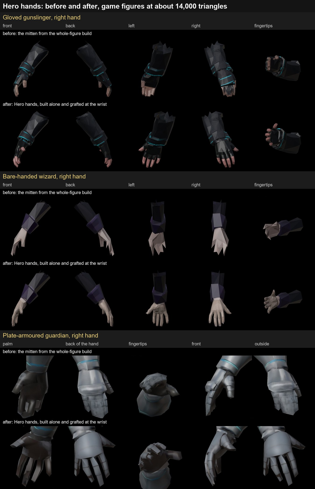

# Hero hands (AssetFurnace add-on)

Gives a rigged figure hands with real fingers. A hand that is a few dozen pixels of a full-body picture comes out of
Pixal3D as a mitten; built on its own it fills Pixal3D's whole box and keeps its fingers. This add-on builds each hand
alone and grafts it on at the wrist, keeping the figure's skeleton and body weights.

## What it does

Give it the GLB from Rig and the front picture the figure was built from. It writes the same figure with new hands:

1. **measure**: the rig finds both arms by the shape of the bone tree; along each forearm the narrowest section
   between the palm and a cuff (or the forearm) is the wrist. No bone names, no hand-drawn box.
2. **crop**: the hand and its cuff are cut from the picture and upscaled 4x (Real-ESRGAN).
3. **draw**: AssetFurnace's picture editor (FLUX.2 [klein], edit mode) redraws the crop as the same hand seen flat
   from its back, fingers down and apart; eight drawings, kept only when their outline counts five digits and one
   thumb. In an A-pose picture a hand hangs beside the thigh seen from the thumb's side with the fingers stacked, and
   built from that Pixal3D guesses their number (six, on the first try), so the hand is redrawn first.
4. **build**: Pixal3D on each kept drawing, two seeds each, kept only when the built hand counts five digits and a
   thumb from twelve sides, its palm is solid (an armoured hand can come out as a plate round an empty inside) and its
   wrist closes where the figure's cut falls.
5. **clean**: Pixal3D's own clean-up of that build.
6. **graft**: each arm cut straight through below the cuff, the new hand put on at the old hand's place, length and
   turn, eased into the wrist and stitched to it as one surface. The new hand takes the old hand's bone weights, and
   it is as fine as the figure round its wrists, so a game-ready step thins it with the rest of the figure.
7. **check**: each grafted hand's digits are counted again, on the figure.

**Left hand**: `mirror` (the default) builds the right hand and mirrors it, for a figure symmetric there; `own` draws
and builds the left hand from its own crop. **What the hands wear** (optional): words for the drawing, such as
`black fingerless gloves, black cuffs with teal stripes`, when the picture is too small to show it; leave it empty to
keep the picture's own.

The result is `<run>.glb`; its numbers (the wrists, the digit counts, the sizes) are in `<run>.hands.json`, and every
step's files (the drawings, the hand builds, `run.log`) in `work/`. Where the code is unsure, the log says `UNSURE`:
that is where to look. A run takes about ten minutes on an RTX 4070 Ti SUPER, most of it Pixal3D.

## What it needs and does on your machine

- AssetFurnace 0.6.0 or newer with **Pixal3D** (and its own clean-up), the **picture editor FLUX.2 [klein]** and the
  **Hero face upscaler** (Real-ESRGAN) set up on its Setup page. The add-on downloads nothing and ships no models;
  it stops at once and says what is missing.
- Runs entirely on your machine; no network.
- Starts Blender (4.2 or newer) as AssetFurnace's add-on runner asks. From it, it starts **AssetFurnace's own Python**
  (the install's `.venv`, where numpy, Pillow, SciPy and OpenCV already are; set `I2L_PYTHON` to use another) to run
  `scripts/hero_hands.py`, which runs AssetFurnace's own picture editor, Pixal3D and upscaler.
- Reads only the model and the picture you give it; writes only into the run folder AssetFurnace gives it.

Models it runs, all AssetFurnace's own, with their licences:

| Model | Licence |
|---|---|
| FLUX.2 [klein] 4B (with the Qwen3-4B text encoder) | Apache-2.0 |
| Pixal3D (`raven38/pixal3d-sv-q8_0-v1`) | MIT (code and flow weights); DINOv3 License (bundled image encoder) |
| Real-ESRGAN x4plus | BSD-3-Clause |

## Use

In the studio: Add-ons, Hero hands. From the command line:

    ./lab addon add --unlisted https://github.com/Ahnyth/assetfurnace-hero-hands@<commit>
    ./lab addon run hero-hands hands --input model=output/animate/<run>/<name>_rigged.glb \
        --input picture=<the front picture> --input left=mirror --input look=

The entry and the launcher are tested without AssetFurnace: `python -m pytest tests`. The hand code's own tests come
along too and run against an install: `I2L_ROOT=<install> <install>/.venv/Scripts/python -m pytest tests`. The
scripts come from the branch [`feat/hero-hands`](https://github.com/Ahnyth/image-to-3dlab/tree/feat/hero-hands) of
my AssetFurnace fork ([image-to-3dlab#307](https://github.com/Bingeljell/image-to-3dlab/pull/307)): `scripts/hero_hands.py`
as it is there, and its hand module `image_to_3dlab/hero_hands.py` as `extra/hero_hands.py`, which the launcher lends to
the installed package.

It has rebuilt the hands of figures in a small mobile game made with AssetFurnace.

Licence: Apache-2.0 (see `LICENSE` and `NOTICE`: the scripts build on [image-to-3dlab](https://github.com/Bingeljell/image-to-3dlab), AssetFurnace itself).
